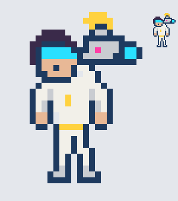

# Ficha: Flash, la camarógrafa del show

> **Estado: borrador para aprobar** (2026-10-26). Primera ficha de MATCH. Reemplaza al **Sniper**, el que más gana hoy
> (59% de las partidas en el banco). Nada de esto está programado todavía: primero lo aprobás o lo cambiás.

*(Boceto para aprobar el aspecto: `docs/arte/competidor-flash.py`. No es el sprite final.)*

## Quién es
Camarógrafa del propio show "En Vivo". Se metió a competir porque conoce cada ángulo de la arena. Pelea con lo que
tiene: la cámara al hombro, un flash enorme y el ojo para el "primer plano".
- **Silueta:** la cámara grande al hombro, con el flash arriba (se reconoce de lejos). Visor cian, campera hueso.
- **Colores:** amarillo del flash (lo que pega) y cian del visor y la lente; la luz magenta "EN VIVO" de la cámara.
- **Rol:** distancia y control. Gana pegando de lejos y encandilando; pierde si la agarran de costado o de cerca.

## Atributos y base (comparada con el Sniper)
Atributo principal: **Reflejos**. Los números siguen la escala de hoy (la de los atributos nuevos está pendiente).

| | Sniper hoy | **Flash** | Por qué |
|---|---|---|---|
| Vida base | 85 | **90** | Un poco más firme: su juego es aguantar el cara a cara de lejos. |
| Daño base | 8 | **7** | Pega menos por golpe: el daño extra sale de su marca. |
| Velocidad de ataque | 0,85 | **0,9** | |
| Rango | 5 | **4** | Menos que el Sniper: hoy el rango largo gana sin que el otro pueda hacer nada. |
| Blindaje / Reflejos / Procesador | 16 / 22 / 15 | **17 / 20 / 16** | Ganancia por nivel: 1,8 / 2,6 / 1,6. |

## Su sello (innato): **Primer Plano**
Cada golpe básico suyo le pone al rival una **marca de cámara** (se ven sobre su cabeza, como cargas): hasta **3**, duran
**4 s**. Cada marca hace que el rival reciba **+4% de daño de todos** (máximo +12%).
- **Lectura:** las marcas están a la vista. El rival sabe que, cuanto más tiempo se quede en su rango, peor.
- **Respuesta:** salir del rango 4 s y se borran.

## Sus módulos

### 1. **Flash** (el golpe fuerte, anunciado)
- **Aviso:** 0,7 s de preparación. En el piso aparece un **cono rojo** (60°, 4 casillas de largo) hacia donde apunta, y
  la cámara se ilumina. Se corta si la aturden en ese tiempo.
- **Efecto:** daño chico (40% de su daño + 10% de Procesador). Al que está en el cono **viniendo hacia ella o quieto** lo
  **encandila**: sus golpes fallan el **50% por 2 s**. Al que se está **alejando** solo le hace el daño.
- **Después:** queda **expuesta 0,4 s** (no puede atacar ni moverse).
- **Enfriamiento:** 12 s · **Energía:** 40.
- **Lectura:** ¿me salgo del cono (y dejo de pegarle) o me la juego? ¿O le corto la preparación?
- **Respuesta:** **entrarle de costado**, salir del cono caminando o darse vuelta.

### 2. **Zoom** (la posición)
- Da **2 casillas para atrás** de un salto, mirando al rival, y su próximo golpe en 3 s tiene **+2 de rango y +40% de
  daño** (y pone 2 marcas de una).
- **Enfriamiento:** 10 s · **Energía:** 30.
- **Lectura:** si te acercás, ella se aleja y te castiga. ¿La perseguís o esperás a que lo gaste?
- **Respuesta:** esperar el Zoom y recién ahí cerrar la distancia.

### 3. **Toma Larga** (pasiva)
- Si se queda **quieta 1 s** filmando, gana **+20% de velocidad de ataque** mientras no se mueva. Se pierde al caminar.
- Encaja con "no se pega caminando": su fuerza está en plantarse.
- **Lectura y respuesta:** se ve en la cámara (la luz "EN VIVO" fija). Moverla, obligarla a caminar, le saca la ventaja.

### 4. Definitiva: **Repetición**
- **Aviso:** 1,2 s canalizando, con el símbolo de "rebobinar" grande sobre el rival. Se corta aturdiéndola.
- **Efecto:** el rival **revive el 60% del daño que ella le hizo en los últimos 3 s**, de una.
- **Enfriamiento:** 60 / 50 / 40 s · **Energía:** 100 / 120 / 140.
- **Lectura:** cuanto más le pegó antes, más duele. Ella busca el momento justo después de una buena racha.
- **Respuesta:** cortarle la canalización, o no comerse golpes justo antes (salir del rango cuando ves que la carga).

## Cómo pelea un duelo con ella
1. Planta (Toma Larga) y pega de lejos poniendo marcas.
2. Si el rival se acerca: Zoom para atrás y un golpe fuerte.
3. Cuando el rival viene de frente: Flash, y lo deja fallando la mitad.
4. Después de una buena racha: Repetición.

**Cómo se le gana:** de costado y sin darle tiempo. Guardar un aturdimiento para el Flash o la Repetición. Hacerla
caminar para que pierda la Toma Larga.

**Buenos y malos cruces (a medir):**
- Bien contra los de cuerpo a cuerpo que vienen de frente (los encandila).
- Mal contra **Kilo** (los drones pegan por él: encandilarlo a él no los frena).
- Mal contra **Glitch** (le copia el Flash).
- Parejo contra **Vector**: él guarda la guardia para su golpe cargado, ella guarda el Flash.

## Frases del show
- **Al entrar:** "¡Luces, cámara... y vos, al piso!" · "Sonreí, que salís en todas las pantallas."
- **Al ganar un duelo:** "Corte. Se imprime." · "Esa toma va a la repetición."
- **Al perder:** "Se me fue de foco..." · "¡Corten! ¡Corten!"
- **El conductor la presenta:** "¡Desde detrás de cámara, la que nunca se pierde un ángulo... FLASH!"

## Lo que hace falta en el motor
| Pieza | ¿Existe? |
|---|---|
| Marcas con cargas a la vista y +% de daño recibido | Casi: existe `dmgTakenPct` (lo usa Condenado); faltan las cargas sobre la cabeza. |
| Preparación anunciada con marca en el piso (cono) y que se corte aturdiendo | La Torre tiene avisos (`towerTelegraph.js`); falta traerlos a MATCH, con forma de cono. |
| Encandilado (falla el 50% de sus golpes) | Nuevo, chico: una probabilidad de fallar en el golpe básico. |
| "Viniendo hacia ella o quieto" | Nuevo, chico: mirar hacia dónde camina el rival. |
| Salto para atrás (Zoom) | Hay movimientos de habilidad (Danzante); se reusa. |
| Repetición (guardar el daño de los últimos 3 s) | Nuevo, chico: un registro del daño que ella hizo. |

## Qué medir cuando esté jugable
- Gana entre el **45% y el 55%** de sus duelos en el banco (el Sniper hoy, mucho más).
- Sus duelos duran más que los del Sniper (meta del juego: 15 a 30 s).
- El piloto evita entre el **30% y el 70%** de sus Flash.
- Ningún cruce 80 a 20.

## (decisión) Para aprobar
1. **El encandilado:**
   - **a) Falla el 50% de sus golpes 2 s (recomendado):** fuerte pero no anula; se sigue peleando.
   - b) Falla todos sus golpes 1,2 s: más claro, más frustrante.
   - c) No puede apuntar módulos 2 s: pega, pero no tira habilidades.
2. **La definitiva:**
   - **a) Repetición (recomendada):** premia jugar bien antes; se lee y se corta.
   - b) Corte a Comerciales: saca al rival del duelo 1,5 s y ella se cura un 15%.
3. **El aspecto:** ¿el boceto va (camarógrafa con cámara al hombro y flash), o la querés distinta?
