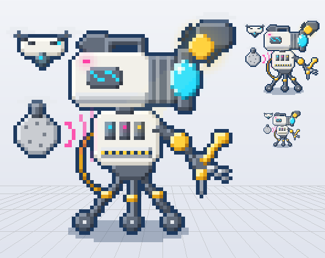

# Ficha: Rec, el camarógrafo robot del show (y su Equipo de Grabación)

> **Estado: borrador para aprobar** (2026-10-26). Primera ficha de MATCH. Reemplaza al **Sniper**, el que más gana hoy
> (59% de las partidas en el banco). Nada de esto está programado todavía.
> **Rediseñado por el usuario (2026-10-26):** robot sobre un trípode de ruedas, con la cara de cámara de TV, un brazo con
> herramientas y 3 drones que salen de su cuerpo; su habilidad principal es **Cámara Fija** (canalizada).

*(Boceto para aprobar el aspecto: `docs/arte/competidor-rec.py`. No es el sprite final.)*

## Quién es
El camarógrafo del propio show "En Vivo": un robot de estudio que se metió a competir. No tiene cara: **su rostro es una
cámara de TV**, con la lente como ojo y la luz roja de "grabando".
- **Cuerpo:** un **trípode de 3 patas con ruedas** (se planta o rueda), un torso con 3 bahías y **un brazo con varias
  herramientas** (llave, pinza, destornillador).
- **Sus 3 drones son parte de su cuerpo** y se despliegan de él:
  - **el aéreo**, que graba desde arriba (pega **físico**);
  - **el de sonido**, un micrófono volador (pega **mágico**);
  - **el de luz**, el reflector (pega **puro**: ignora armadura y resistencia, y quema).
- **Su nombre es Rec** (decidido por el usuario). Rec y sus tres drones, juntos, son el **Equipo de Grabación**.
- **Colores:** hueso y gris de estudio, cian de la lente, magenta de la luz "grabando", amarillo de la luz y las
  herramientas.
- **Rol:** distancia y control. Se planta, encuadra y castiga; pierde si lo agarran de costado o lo obligan a moverse.

## Atributos y base (comparada con el Sniper)
Atributo principal: **Reflejos**. Los números siguen la escala de hoy (la de los atributos nuevos está pendiente).

| | Sniper hoy | **Rec** | Por qué |
|---|---|---|---|
| Vida base | 85 | **95** | Es un robot de estudio, más firme; su juego es plantarse. |
| Daño base | 8 | **7** | Pega menos por golpe: el daño grande es de los drones. |
| Velocidad de ataque | 0,85 | **0,85** | |
| Rango | 5 | **4** | Menos que el Sniper: hoy el rango largo gana sin que el otro pueda hacer nada. |
| Velocidad | 2,3 | **2,1** | Rueda, pero no es rápido. |
| Blindaje / Reflejos / Procesador | 16 / 22 / 15 | **18 / 19 / 16** | Ganancia por nivel: 2,0 / 2,4 / 1,6. |

## Su sello (innato): **Equipo de Grabación** (diseño del usuario)
**Rec no pega: pegan sus 3 drones.** Cada ataque básico manda a los tres contra el objetivo, y llegan **siempre en
este orden**:

| Orden | Dron | Daño | Por golpe (propuesta) | Velocidad propia (propuesta) |
|---|---|---|---|---|
| 1º | **Aéreo** (graba desde arriba) | **físico** | 50% de su daño | rápido: 6 casillas/s |
| 2º | **Sonido** (el micrófono) | **mágico** | 35% de su daño | medio: 4,5 casillas/s |
| 3º | **Luz** (el reflector) | **puro, y quema** | 15% de su daño + quemadura | lento: 3,5 casillas/s |

- **La quemadura de la luz:** 2 de daño puro por segundo durante 2 s (no se acumula: cada golpe la renueva).
- **Cada dron se mueve solo**, con su velocidad: vuelan desde Rec hasta el objetivo y vuelven. Si el objetivo se
  aleja corriendo, los lentos llegan tarde (el de luz es el que más cuesta que llegue).
- **Los drones no se pueden atacar** (ni con golpes ni con daño de área).
- **Se los frena de a uno con habilidades de punto de objetivo** (las que se apuntan a un lugar o a alguien, decidido por
  el usuario). Según lo que haga la habilidad:
  - **aturdir:** el dron queda quieto y sin pegar;
  - **ralentizar:** el dron vuela más lento (llega más tarde al objetivo);
  - **silenciar:** **el de sonido (mágico) y el de luz (puro) no pueden atacar**; el aéreo (físico) sigue;
  - **atar al suelo:** el dron no se puede mover (pega solo si el objetivo pasa por al lado).
- **Si aturden a Rec, se frenan los tres:** mientras Rec está aturdido, ningún dron ataca ni se mueve.
- **Lectura:** se ve dónde está cada dron y qué le pasa (aturdido, lento, callado, atado). ¿Le saco un dron con mi
  habilidad apuntada, o la guardo para Rec y freno a los tres?
- **Respuesta:** aturdir a Rec (frena todo); silenciar para apagar dos drones de una; atar o aturdir drones sueltos;
  correrse para que los lentos no lleguen.

## Sus módulos

### Su categoría
**Tirador de control** (hoy, en el juego, los de Reflejos de distancia: como el Sniper al que reemplaza).
- **No es asesino:** no tiene cómo entrar rápido ni matar de golpe; se planta y pega de lejos.
- **No es mago:** su daño sale de los ataques básicos (los drones), no de habilidades.
- **No es tanque:** no está hecho para comerse los golpes.
- **Sí es tirador:** pega constante de lejos y crece con los ítems de ataque.
- **Y controla:** la Cámara Fija ralentiza y encierra; sus drones se pueden "apagar", que es su punto débil.

### Las 3 que faltan (propuesta para que vayan a juego; el usuario decide)
Regla del juego: al menos una pasiva. Cada una usa una parte de su cuerpo o un dron.

**1. Acople** (el dron de sonido, activa)
- **Aviso:** 0,6 s. El micrófono sale y en el piso se marca **una línea roja** de 6 casillas hacia donde apuntás (es de
  punto de objetivo).
- **Efecto:** un chillido de acople que recorre la línea: daño mágico (60% de su daño + 15% de Procesador) y
  **silencia 1,5 s** al primero que toca.
- **Enfriamiento:** 11 s · **Energía:** 45.
- **Por qué va:** le da su propia forma de cortar a los demás (y de defenderse de los que lo silencian a él).
- **Lectura y respuesta:** la línea se ve; correrse de costado.

**2. Travelling** (las ruedas, activa)
- Pliega el trípode y **rueda 3 casillas** hacia donde apuntás (se puede usar para alejarse); los drones lo siguen.
  Al frenar, su próximo ataque tiene **+2 de rango**.
- **Enfriamiento:** 12 s · **Energía:** 30.
- **Por qué va:** un tirador necesita cómo escapar; sin esto, el que lo alcanza lo mata.
- **Lectura y respuesta:** esperar a que lo gaste y recién ahí cerrarle la distancia.

**3. Trípode** (pasiva)
- Si se queda **quieto 1 s**, clava las patas: **sus drones vuelan 30% más rápido** mientras no se mueva (llegan antes y
  pegan más seguido).
- **Por qué va:** junta su cuerpo con los drones y con la Cámara Fija (que también lo deja clavado). Obligarlo a moverse
  es la respuesta.
- **Se ve:** las patas se abren y la luz de "grabando" queda fija.

Las ideas anteriores que no entraron: *Destello* (el reflector encandila en cono) y *Primer Plano* (marcas que suben el
daño recibido). Se pueden cambiar por cualquiera de las tres.

### Definitiva: **Cámara Fija** (diseño del usuario)
- **Aviso:** 0,5 s. Clava el trípode y en el piso aparece **un cono rojo delante de él** (60°, 5 casillas). Al terminar el
  aviso, **fija como objetivo al rival más cercano dentro del cono** (si no hay nadie, no pasa nada y el enfriamiento
  queda en 10 s).
- **Canalización de 3 s:** Rec se queda **fijo**. El objetivo queda **ralentizado 40%** y **los 3 drones lo atacan**:
  cada uno le pega **una vez por segundo**, en el orden de siempre (físico, mágico, puro), con **daño fijo** (no
  depende de los atributos):

  | Dron | Tipo | Por golpe (nivel 1 / 2 / 3) | En los 3 s |
  |---|---|---|---|
  | Aéreo | físico | 10 / 15 / 20 | 30 / 45 / 60 |
  | Sonido | mágico | 10 / 15 / 20 | 30 / 45 / 60 |
  | Luz | puro, y quema | 6 / 9 / 12 | 18 / 27 / 36 (+ la quemadura) |

  En total, 78 / 117 / 156 antes de armadura, resistencia y el ajuste de duelo (en duelo, hoy, −60%).
- **Se corta si:** aturden a Rec (los tres drones se frenan), el objetivo sale a más de **7 casillas**, o muere. Si
  frenan **un** dron (aturdido, callado o atado), solo ese deja de pegar; los otros siguen.
- **Enfriamiento:** 60 / 50 / 40 s · **Energía:** 100 / 120 / 140.
- **Lectura:** el cono avisa medio segundo antes: el rival puede salirse. Una vez fijado, ¿corro (lento) para salir del
  alcance, aturdo a Rec, o le saco un dron con una habilidad apuntada?
- **Respuesta:** salir del cono en el aviso; aturdir a Rec para cortar todo; silenciar (apaga el de sonido y el de luz); o correr lejos.
- **Por qué tres tipos de daño:** ninguna defensa sola alcanza (la armadura frena al aéreo, la resistencia al de sonido y
  nada frena al de luz). Premia armar defensa mezclada contra él.

## Cómo pelea un duelo
1. Se planta (Trípode) y sus drones pegan en cadena: físico, mágico y puro con quemadura.
2. Si lo quieren cortar: Acople (silencia al que viene).
3. Si lo alcanzan: Travelling para alejarse.
4. Con el rival encuadrado: Cámara Fija.

**Cómo se le gana:** guardar el aturdimiento para Rec (frena a los tres drones), silenciar (apaga dos de una),
sacarle drones sueltos con habilidades apuntadas (el de luz, que quema, es el mejor para sacar) y moverse para que los
lentos lleguen tarde.

**Cruces (a medir):**
- Bien contra los que se defienden con un solo tipo de defensa (los tres tipos de daño).
- Mal contra quien tenga aturdimientos rápidos y silencios (le frenan los drones).
- Mal contra **Glitch** (le copia la Cámara Fija).
- ⚠️ **Kilo también tenía drones** (de entrega). Para que no se pisen, propongo que Kilo cambie los drones por otra cosa
  cuando hagamos su ficha (por ejemplo, paquetes que tira y explotan).

## Frases del show
- **Al entrar:** "Grabando." · "Tres, dos, uno... ¡al aire!"
- **Al ganar un duelo:** "Corte. Se imprime." · "Esta va a la repetición."
- **Al perder:** "Señal... perdida..." · "Fuera de foco."
- **El conductor lo presenta:** "¡El que nunca se pierde una toma, el ojo del show... REC y su Equipo de Grabación!"

## Lo que hace falta en el motor
| Pieza | ¿Existe? |
|---|---|
| Daño físico, mágico y puro | Sí (`dealDamage` en `js/combat.js`). |
| Quemadura (daño puro por segundo) | Hay daño en el tiempo en otros héroes; se reusa con daño puro. |
| **Drones: unidades que vuelan solas** con su velocidad, que no se pueden atacar y pegan por él | **Nuevo**, la pieza grande. |
| Aturdir un dron solo con un mágico; aturdir a Rec frena a los tres | Nuevo, sale con los drones. |
| Aviso con cono en el piso | La Torre tiene avisos (`towerTelegraph.js`); falta traerlos a MATCH, con forma de cono. |
| **Canalización** (quieto, se corta con aturdimiento o distancia) | **Nuevo.** Pieza general: la van a usar otros. |
| Dibujo y animación de los drones saliendo, volando y volviendo | Nuevo. |

## Qué medir cuando esté jugable
- Gana entre el **45% y el 55%** de sus duelos en el banco.
- Sus duelos duran más que los del Sniper (meta del juego: 15 a 30 s).
- El piloto evita entre el **30% y el 70%** de sus Destellos y Cámaras Fijas (saliéndose en el aviso o cortándolas).
- Ningún cruce 80 a 20.

## (decisión) Para aprobar
**Ya decidido por el usuario (2026-10-26):**
- Se llama **Rec**; con sus drones son el **Equipo de Grabación**.
- Robot con trípode de ruedas, cara de cámara de TV, brazo con herramientas y 3 drones que son parte de su cuerpo.
- Los drones son su ataque, en orden: físico (aéreo), mágico (sonido), puro que quema (luz); cada uno con su velocidad.
- No se pueden atacar. Se frenan de a uno con habilidades de punto de objetivo que aturden, ralentizan, silencian
  (callado: el de sonido y el de luz no pegan) o atan al suelo; aturdir a Rec frena a los tres.
- **Cámara Fija es su definitiva** (por ahora).

Queda abierto:
1. **La categoría:** **a) Tirador de control (recomendado)**; b) Controlador puro (menos daño de ataque, más control).
2. **Las 3 habilidades:** ¿van Acople, Travelling y Trípode, o cambiás alguna?
3. **El boceto nuevo:** ¿así va, o le cambiamos algo (colores, forma de la cabeza, drones)?
