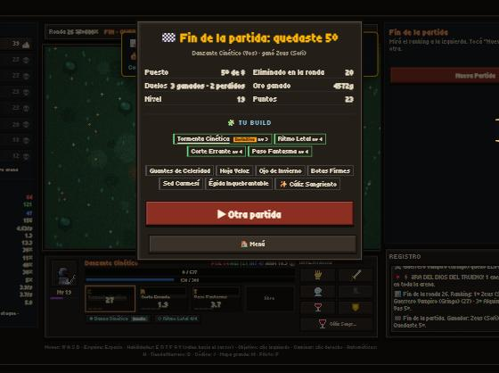
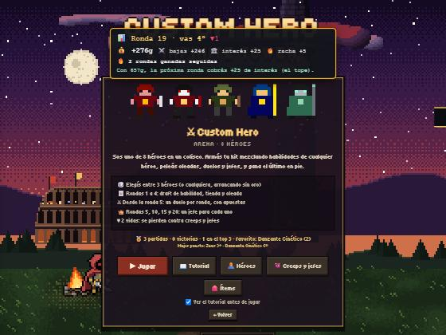
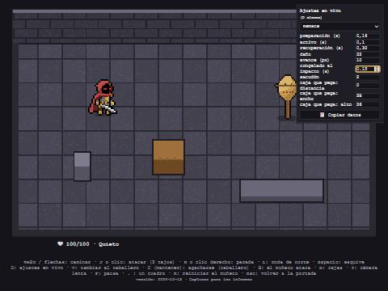

# Informe del 18 de octubre de 2026

Uso del plan: al empezar, 5 horas 0% y semanal 0%. Al terminar, 5 horas 20% y semanal 3%.

La corrida arrancó sola (la de cada hora). En el medio le pediste que parara, y después que **avanzara solo con
Custom Hero y pusiera en pausa Infinite Tower**. Eso quedó anotado arriba de todo en el roadmap, así que las próximas
corridas automáticas trabajan solo en Custom Hero hasta que digas otra cosa. La Torre no se tocó: sigue jugable como está.

## Qué hice

**Custom Hero: pantalla de fin de partida** (commit 47f1130). Cuando termina la partida, o cuando te eliminan, aparece
una ventana con tu puesto, las rondas (o en qué ronda quedaste afuera), los duelos ganados y perdidos, todo el oro que
ganaste en la partida, el nivel, los puntos y tu build: las habilidades con su nivel (con el color del héroe de donde
vienen), los ítems y el neutral. Abajo: "▶ Otra partida" (te lleva directo a elegir héroe), "🏠 Menú" y, si te
eliminaron y la partida sigue, "👁 Seguir mirando". Probado con dos partidas enteras del piloto: quedó 7º (afuera en la
ronda 25, 0-7 en duelos, 5330 de oro) y 5º (afuera en la 20, 3-2, 4572 de oro).

**Custom Hero: historial y perfil** (commit 35b9e73). En el menú de Custom Hero ahora ves tus partidas, victorias,
cuántas veces quedaste en el top 3, tu héroe favorito y el mejor puesto con cada héroe. Cada partida se cuenta una sola
vez. Se guarda aparte, como los récords de la Torre, sin tocar nada de lo que ya tenías guardado. De paso arreglé que la
tarjeta de la última ronda ("Ronda 19 · vas 4º") se quedaba arriba en el menú.

**Volver a la portada deja todo limpio** (commit 6ec6897). Agregué una prueba que juega Torre, vuelve a la portada,
juega Custom Hero, vuelve y entra de nuevo a la Torre. Encontró dos cosas que pasaban de un juego al otro: el piloto
automático prendido en la Torre seguía jugando tu partida de Custom Hero, y el inventario (y la tienda, el herrero y la
Bitácora) podían quedar abiertos encima del menú. Las dos arregladas.

**El muñeco de prueba: ajustes en vivo** (commits 5ba13c3, 2191727 y fde2499). En `index.html?muneco`, con la tecla
**O** se abre un panel a la derecha: elegís un movimiento (un tajo, el esquive, la parada…) y le cambiás los tiempos,
el daño, el avance, el empujón, el congelado al pegar, el sacudón y el tamaño de la caja que pega, mientras jugás. Lo que
cambiaste se marca en amarillo. Los números ahora están en un archivo aparte (`js/munecoDatos.js`): "📋 Copiar datos"
te da ese archivo ya armado para pegarlo. En "⚙️ General" están la bola de paja del muñeco y los congelados que antes
estaban fijos en el código. Mientras escribís en el panel, las teclas ya no mueven al héroe.

**Capturas para los informes** (commit 2fcb4f6). Un servidor de prueba (`python docs/captura.py`) que deja guardar
capturas del juego en `docs/informes/img/`. Por eso este informe ya trae imágenes.

## Qué quedó pendiente o a medias

- **Cajas de golpe en la Torre:** en pausa, junto con la Torre. Lo único que llegué a medir: la caja del tajo del
  muñeco alcanza lo mismo que el cono de la espada de hoy (más las dos casillas de los costados). O sea, pasarla no
  cambia el alcance. Lo que sí cambiaría es el momento del golpe: hoy pega al instante y en el muñeco pega después de
  la preparación. Está anotado en el ítem.
- **Lo próximo de Custom Hero** (para la corrida automática): Fase C3, Chakravin `Y` (un héroe nuevo con proyectiles
  que vuelven y el creep Guardián de Hierro). Después vienen el Trampero, la Fase C4 y, al final, el balance.

Decisiones que esperan tu respuesta:
- **Cuadros de frente y de espaldas de la espada** (nueva): como sacaste el borrador y pediste el caballero afuera, la
  corrida no los dibuja. Opciones: (a) **esperar el arte del caballero y recortarlo (recomendada)**; (b) que se dibujen
  en código sobre las piezas del héroe calcado; (c) dejar el dibujo de costado para arriba y abajo hasta la 1.0. (Es
  de la Torre, así que igual está en pausa.)
- **El Sniper mientras tanto:** (a) **dejarlo como está hasta el balance del final (recomendada)**; (b) sacarlo de la
  elección por ahora; (c) alcance 4 ya.
- Siguen las de antes: editor externo de pixel art, silueta de la torre en el piso 1, llave del piso desde el misterio
  y pueblos más chicos arriba (todas en "Esperando al usuario" del roadmap).

## Cómo probarlo

Link: https://matiaslcsm-rgb.github.io/custon-hero-chaos/ (si no ves "Versión 2026-10-18 · Custom Hero: historial y
perfil" abajo en la portada, recargá una vez).

- **Fin de partida:** jugá una partida de Custom Hero hasta el final, o hasta que te eliminen. Para verlo rápido,
  prendé el piloto con P y dejalo jugar.
- **Perfil:** después de una partida, en la portada entrá a Custom Hero: debajo de la lista aparece "🏅 N partidas…" y
  "Mejor puesto: …".
- **Panel del muñeco:** en la portada, "🧪 Muñeco de prueba", y apretá O. Cambiá por ejemplo el "congelado al impacto"
  del Remate a 0.2 y pegale tres veces al muñeco con J.
- **Volver a la portada:** en la Torre, prendé el piloto (P) y abrí el inventario. Salí al menú desde la pausa y empezá
  Custom Hero: el piloto tiene que estar apagado y no tiene que quedar nada abierto.

## Tu feedback
¿Algo para editar, sacar o cambiar? Escribilo abajo con tus palabras y guardá el archivo. La próxima corrida lo lee primero y lo pasa al roadmap.

(Escribí acá debajo)

